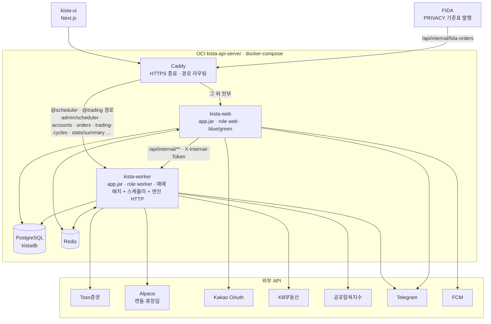
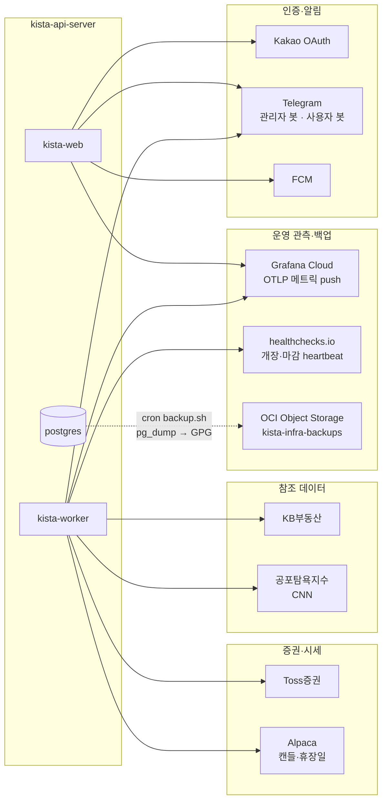
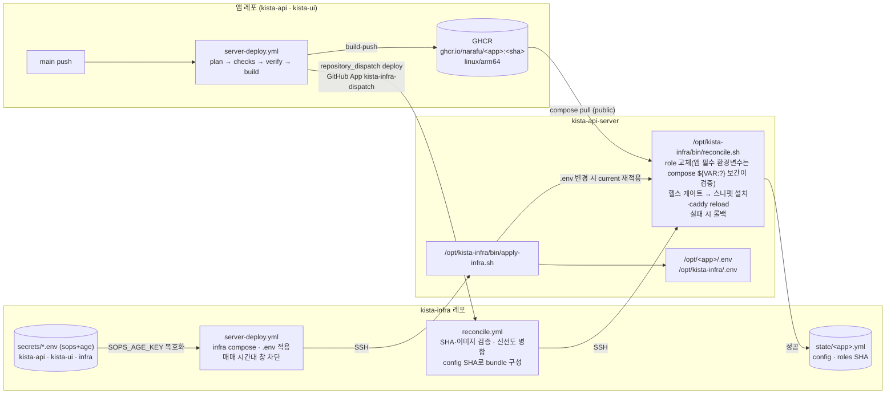
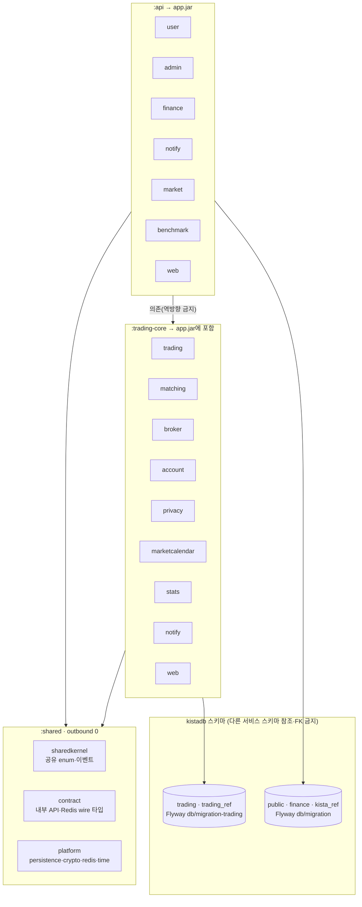
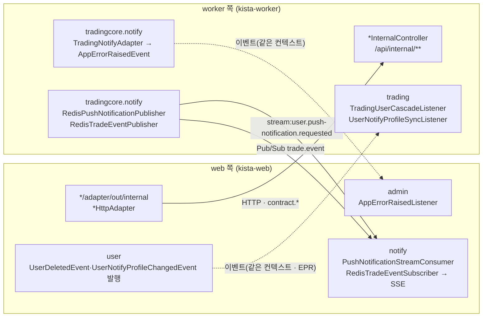

# 아키텍처 맵

전체 구조를 줌 레벨별로 보여주는 그림 모음이다. 텍스트 규칙·모듈 목록의 SSOT는 `docs/agents/architecture.md`이고, 이 문서는 그림과 링크만 둔다 — 서술이 필요하면 그쪽을 고친다.

| 레벨 | 질문 | 위치 |
|---|---|---|
| L0 시스템 컨텍스트 | 어떤 role·외부 시스템이 있나 | 아래 L0 |
| L0-1 배포 구성 | 어떤 컨테이너·네트워크·볼륨에 어떻게 배포되나 | 아래 L0-1 |
| L1 빌드·스키마 경계 | 어느 모듈이 어느 jar·DB 스키마 소속인가 | 아래 L1 |
| L1.5 role 간 통신 | web ↔ worker는 무엇으로 대화하나 | 아래 L1.5 |
| L2 모듈 의존 그래프 | 모듈끼리 누가 누구를 참조하나 | **자동 생성** — 아래 L2 |
| 업무 흐름 맵 | 무엇이 계기가 되어 어떤 순서로 어디까지 가나·하루에 언제 무엇이 도나 | **반자동 생성** — 아래 "아키텍처 맵" |

## L0 시스템 컨텍스트



- 라우팅 SSOT: `deploy/server/caddy/kista-api.caddy` (`CaddyRoutingTest`가 컨트롤러 경로와 대조)
- 배포·role 상세: `docs/agents/docker-infra.md` "서버 배포 방식"

## L0-1 배포 구성

L0을 컨테이너·네트워크·볼륨·배포 경로 수준으로 펼친 그림이다. 소유 레포가 셋으로 갈린다 — `kista-infra`(caddy·postgres·redis·네트워크·시크릿·reconcile), `kista-api`(앱 2 role compose + API 도메인 라우팅 스니펫), `kista-ui`(UI compose).

### 호스트·컨테이너·네트워크 (kista-infra README)

컨테이너·네트워크·Caddy 라우팅 그림은 kista-infra [`README.md` 배포 구성도](https://github.com/narafu/kista-infra/blob/main/README.md#배포-구성도)(private, 손으로 관리)가 원본이다. 여기서 다시 그리지 말고 그쪽을 본다.

그림에 없는 의미 정보:
- **role 구분**: 한 `app.jar`(trading-core 포함)를 `KISTA_ROLE`로 가른다 — kista-web은 `web`(엔진 외 HTTP), kista-worker는 `worker`(매매 배치·스케쥴러·엔진 HTTP). role과 맞지 않는 요청은 `RoleRoutingGuard`가 503 `WRONG_ROLE`
- **EPR 재발행 소유**: `public.event_publication` 하나를 kista-worker만 재발행(kista-web은 안 함 — 둘 다 true면 이중 claim)
- **교체 방식**: blue/green은 bundle `bluegreen` 파일의 kista-web·kista-ui만. kista-worker는 단일 인스턴스·stop-first 고정 — 재기동 시 매매 배치 재개가 잔여 락을 인수하므로 겹침 기동 금지(`.github/tests/compose-invariants.bats`)
- **외부 호출자**: 별도 OCI 인스턴스의 fida-server가 공인 API 도메인으로 `/api/internal/fida-orders`를 호출 → Caddy `@trading` → kista-worker
- **DB 연결**: 앱 2 role 모두 data_net으로 postgres에 붙는다(`DB_URL`은 시크릿 `.env`)
- **호스트 경로**: `/opt/<app>/releases/<id>`(bundle) · `current`/`previous`(심볼릭 링크) · `/opt/<app>/.env`, `/opt/kista-infra/.env`(시크릿 렌더링 결과)
- 라우팅 SSOT: `deploy/server/caddy/kista-api.caddy`(API 도메인, 이 레포 소유, `CaddyRoutingTest`) · `kista-infra/Caddyfile`(UI 도메인 + 스니펫 import)

### 외부 연동



- 외부 호출 방향은 L0과 같고, 운영 관측(`GRAFANA_CLOUD_OTLP_*`, `heartbeat.*`는 trading-core만)과 백업 경로를 더했다

### 배포 파이프라인·시크릿



- 앱 배포 설계: `kista-infra/docs/superpowers/specs/2026-10-02-deploy-reconcile-design.md` · 앱 쪽 판정: `.github/scripts/detect-deploy-scope.sh`(변경 경로별 role 선택)
- 시크릿: 운영 `.env` 3종은 `kista-infra/secrets/`에 sops + age 암호화로만 존재(`sops edit secrets/<이름>.env`→커밋, 서버 `.env` 직접 수정 금지) — 앱 키 목록은 이 저장소 루트 `.env.example`. OCI 백업 PEM은 서버 `/opt/kista-infra/oci_backup_key.pem`에만. GitHub Secrets: kista-infra(`SOPS_AGE_KEY`·`SERVER_*`·`TELEGRAM_*`), 앱 레포(`INFRA_APP_CLIENT_ID` 변수 + `INFRA_APP_PRIVATE_KEY`)
- 호스트 단위 reconcile 락으로 앱끼리·infra 재적용과 교체가 겹치지 않는다. 수동 복구(exit 2)·서버 재구축 순서 → `kista-infra/README.md`

## L1 빌드·스키마 경계



- 경계 검증: `GradleModuleBoundaryTest`(Gradle 방향), `InternalApiContractTest`(wire 타입), `ModulithArchitectureTest`(모듈), `HexagonalArchitectureTest`(레이어)

## L1.5 role 간 통신

한 애플리케이션이라 사용자 이벤트(`UserDeletedEvent`·`UserNotifyProfileChangedEvent`)와 오류 보고(`AppErrorRaisedEvent`)는 모듈 리스너가 직접 받는다(`public.event_publication`). 내부 HTTP(web → worker)와 Redis(체결 푸시 Stream·`trade.event` Pub/Sub)는 web·worker 사이 전달용으로 남는다.



- Stream 공통 규약: `platform.redis.RedisStreams`, 키·그룹명: `RedisStreamConfig`
- JWT 블랙리스트도 Redis 공유(root `RedisBlacklistAdapter` 기록 → trading-core `RedisTokenBlacklistReader` 조회)

## L2 모듈 의존 그래프 (자동 생성)

손으로 그리지 않는다. `ModulithArchitectureTest`가 `Documenter`로 실제 의존 기준 PlantUML을 생성한다(`ApplicationModules.of(ApiApplication.class)` 모델 하나 — api 7 + trading-core 9 + shared 3).

```bash
./gradlew :test --tests 'com.kista.api.architecture.ModulithArchitectureTest'
# 출력: build/spring-modulith-docs/components.puml (전체), module-<name>.puml (모듈별)
```

- `.puml`: IntelliJ PlantUML Integration 플러그인으로 열면 렌더링된다
- `build/`는 IntelliJ에서 Excluded라 `Ctrl+Shift+N` 두 번(non-project 포함)으로 찾는다

## 아키텍처 맵 (build/architecture-map/, 반자동 생성)

모듈 구조와 업무 흐름을 한 페이지에서 오간다. 모듈 그래프는 Modulith가, 하루 타임라인은 `@Scheduled`가 자동 공급하고, 흐름 내용만 사람이 `src/test/resources/architecture/flows.yml`에 쓴다.

```bash
./gradlew :test --tests 'com.kista.api.architecture.ArchitectureMapTest'
# 출력: build/architecture-map/index.html (file://로 연다 — cytoscape만 CDN이라 인터넷 필요)
```

- 탭 5개: 구조(모듈 의존 그래프 — 처음엔 `:api`·`:trading-core`·`:shared` 박스로 접혀 있고 박스 클릭·"모두 펼치기"로 모듈을 편다. 노드 클릭 → 나가는·들어오는 의존을 대상 모듈 → 의존 종류 → `소스클래스 → 타깃클래스`로, 엣지 클릭 → 두 모듈 사이 클래스 단위 의존. 의존 종류 필터·platform/sharedkernel 숨김. "흐름 오버레이"를 고르면 단계별 모듈을 강조하고 연속 단계 사이를 의존 엣지 또는 점선 가상 엣지로 이어 재생한다) / 랜드스케이프(사용자 여정은 노선도, 나머지는 카드 — 카드마다 터치 레인 스파크라인·모듈 수) / 흐름(스윔레인 — 레인 = 사용자·kista-ui·kista-web·Redis·kista-worker·DB·증권사·Telegram·외부(fida), 단계 클릭 → 업무 설명·상태 변화·실패 경로·담당 코드, ▶ 재생) / 타임라인(KST 24h 선형, 실행 role별 — cron 시각은 `CronExpression`으로 계산, `@ConditionalOnWorkerRole` 스케쥴러는 `kista-worker`, 그 외는 공용) / 생명주기(user·strategy·order·매매 배치 체크포인트 — 상태를 한 줄에 놓고 전이를 호로)
- URL 해시가 전체 상태다 — `#structure/trading?flow=close-batch&step=lock`, `#flow/close-batch/lock`, `#timeline/TradingCloseScheduler%23run`, `#lifecycle/order/3`. 리뷰 메모에 링크로 남길 수 있다. 헤더 통합 검색(`/`)은 모듈·흐름·단계(제목·code)·잡·상태 enum을 한 목록에서 찾는다
- 상세 패널 하단 "연결"이 뷰를 잇는다 — 모듈 ↔ 거치는 흐름 단계·소속 잡, 단계 ↔ 모듈·생명주기 전이·시작 잡. 단계 → 모듈은 `code:` 클래스 패키지(`com.kista.<module>`)에서 자동 도출(`ArchitectureMapExporter.stepModules`)하므로 flows.yml에 쓰지 않는다. 잡 ↔ 단계는 잡 이름(`Class#method`)이 단계 `code:` 항목과 같으면 연결된다
- `ArchitectureMapTest`가 flows.yml의 `클래스#메서드` 참조·레인·흐름 연결을 검증하고, `lifecycles:`는 상태 enum 상수 집합이 `states`와 정확히 같은지·전이의 상태·`flow: <flowId>/<stepId>` 링크까지 검증한다 — 메서드 이름이 바뀌거나 enum 상수가 늘면 이 테스트가 깨지니 flows.yml을 같이 고친다. 스키마는 flows.yml 머리 주석이 SSOT
- 상세 흐름 18개 — 랜드스케이프 카드 전부 연결. 사용자 여정(가입·승인·계좌 연결·전략 등록·매일 자동 매매·결과 확인·일시정지·재개·삭제·탈퇴), 사용자 기능(바로 주문·주문 취소·알림 설정·가계부·그룹 공유), 자동(개장·마감 배치·FIDA 기준표 수신), 관리자(런타임 매매 정책·체결 보정·스케쥴러 수동 실행·오류 로그·사용자 역할 변경). 새 카드는 flows.yml `flows:`에 키를 추가하고 landscape의 `flow:`로 연결한다
- `code:` 클래스가 어느 모듈에도 속하지 않으면(예: `com.kista` 루트) 같은 테스트가 깨진다 — 오버레이에서 조용히 빠지지 않게
- 생성기는 `ModuleGraphExporter`(모듈 그래프 데이터)·`ArchitectureMapExporter`(flows 검증·잡 수집·`data.js`·정적 파일 복사), 정적 원본은 `src/test/resources/architecture/map/`(셸·`style.css`·`core.js`·`views/*.js` — 디렉토리를 순회 복사하므로 뷰 파일을 추가해도 Java 수정 불필요)
